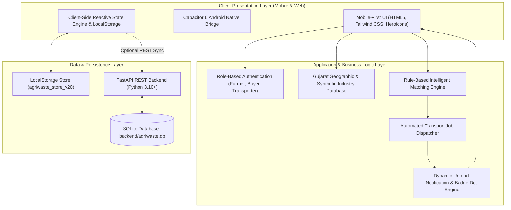
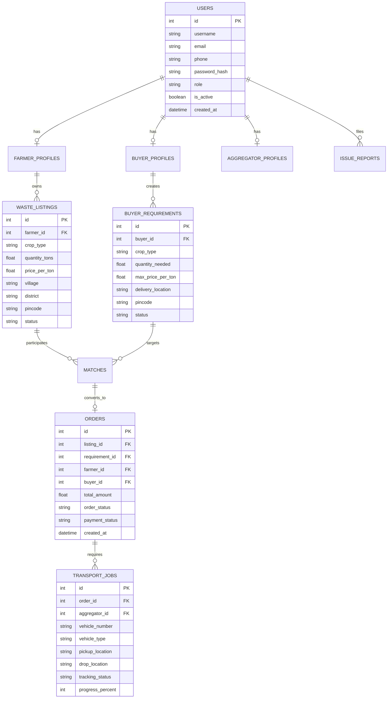

# AgriWaste Exchange — Comprehensive Project Documentation & Technical Architecture

**Project Title:** AgriWaste Exchange  
**Subtitle:** Agricultural Residue Monetization, Industrial Sourcing & Logistics Platform  
**Target Region:** Gujarat, India (Expandable Pan-India)  
**Platform Types:** Mobile-First Web Application (PWA) & Android Hybrid App (via Capacitor)  
**Live Prototype URL:** [https://manasvirachi647.github.io/AgriWaste/](https://manasvirachi647.github.io/AgriWaste/)  
**Document Version:** 2.0 (Final Complete Prototype)  

---

## 1. Executive Summary & Vision

### 1.1 Problem Statement
Across agricultural hubs in India, particularly during the post-harvest seasons, millions of tonnes of agricultural crop residue (paddy straw, wheat straw, cotton stalk, bagasse, groundnut shells) are generated. Due to lack of transparent market linkages, absence of localized transport coordination, and low price transparency, farmers frequently resort to on-field burning (stubble burning) or open dumping. This creates:
1. **Severe Atmospheric Pollution:** Release of particulate matter ($PM_{2.5}$, $PM_{10}$), greenhouse gases ($CO_2$, $CO$, $CH_4$), and smog hazards.
2. **Loss of Organic Wealth:** Destroys topsoil microbial biodiversity and wastes potentially valuable biomass.
3. **Industrial Raw Material Scarcity:** Modern paper mills, biomass-to-energy power plants, bio-fuel producers, boiler facilities, and packaging industries struggle to acquire reliable, aggregated, quality-tested biomass at predictable prices.

### 1.2 The AgriWaste Exchange Solution
**AgriWaste Exchange** is an integrated, 3-sided circular economy marketplace that connects:
- **Farmers (Producers):** Who can list surplus residue, set fair prices, and earn supplementary income.
- **Industrial Buyers (Consumers):** Who can publish biomass requirements, discover matching regional farmers, and execute transparent purchase deals.
- **Transporters / Aggregators (Logistics):** Who receive automated haulage jobs, utilize rural transport fleets (tractors, trolleys, mini trucks), provide real-time shipment updates, and earn steady logistics revenue.

---

## 2. Complete Technical Stack & Architecture



### 2.1 Technology Matrix
| Layer | Technology | Version | Purpose |
| :--- | :--- | :--- | :--- |
| **Frontend Framework** | Vanilla HTML5 / JavaScript (ES2022) | Native | High performance, zero bundling overhead, instant mobile execution |
| **CSS & Design Engine**| Tailwind CSS (JIT via CDN) | 3.x | Clean utility classes, responsive mobile shell, dark accents |
| **Typography** | Plus Jakarta Sans (Google Fonts) | Variable | Modern, highly legible font for rural and enterprise interfaces |
| **Mobile Runtime** | Capacitor (Ionic Framework) | 6.x | Wraps Web app into native Android `.apk` with hardware bridge |
| **Backend API** | FastAPI (Python) | 0.100+ | Asynchronous high-speed RESTful API |
| **ORM / Database** | SQLAlchemy / SQLite3 | SQLite 3 | Relational schema storage for users, listings, jobs, orders |
| **Authentication** | JSON Web Tokens (JWT) & Bcrypt | HS256 | Secure token-based session verification |
| **Hosting & CI/CD** | GitHub Pages & GitHub Actions | Native | 100% uptime, zero-cost static hosting with instant edge deployment |

### 2.2 Dual-Engine Resilience Architecture (Offline-First)
The application is engineered with a **hybrid resilience engine**:
1. **Synchronous In-Memory Client Engine:** If backend servers are unreachable or the app is opened offline in remote farming regions, the application operates self-sufficiently using a robust JavaScript client store (`agriwaste_store_v20`) backed by browser `localStorage`.
2. **REST API Bridge:** When connected to the FastAPI backend (`http://localhost:8000/api/v1`), the frontend automatically syncs auth tokens, residue listings, orders, and tickets to the SQLite database.
3. **Clean-State Auto-Purge:** On first launch, the version control key (`agriwaste_fresh_launch_v20`) guarantees that any cached test accounts or legacy sessions are wiped, ensuring every presentation demo starts at a clean, zero-data registration state.

---

## 3. UI/UX Design System & Mobile Interface

### 3.1 Viewport & Screen Anatomy
The application is designed mobile-first (`max-w-md mx-auto min-h-screen bg-slate-50`), providing the visual look and feel of a native iOS/Android application:
- **Sticky Top Bar:** Displays user avatar, verified name, role badge (`Farmer`, `Buyer`, `Aggregator`), registered location pin, and one-tap Profile shortcut.
- **Slide-Over Hamburger Drawer (Left):** 
  - Opened via top-left `☰` button.
  - Houses all secondary operations: *My Listings, Browse Demand, Best Matches, Order History, Earnings, Transport Schedule, Help & Disputes*.
  - Features a **live unread indicator dot** (pulsing emerald) on both the hamburger button and specific menu items when new matches or transport jobs arrive.
- **Dynamic Action Views:** Switch without full-page reloads, preserving memory and state.
- **Sticky Bottom Navigation Bar:** Contextual tabs tailored to the logged-in user role:
  - **Farmer:** `Home` (Residue list & deals), `Add Residue` (`+` button), `Suppliers / Matches`, `Profile`.
  - **Buyer:** `Home` (Active requirements), `Post Requirement` (`+` button), `Best Matches`, `Profile`.
  - **Transporter:** `Home` (Active trips & earnings), `Find Jobs`, `Trip Tracker`, `Profile`.

### 3.2 Color System & Visual Identity
- **Primary Agro Green (`#15803d` / `agri-700`):** Represents healthy crops, sustainable biomass monetization, and ecological vitality.
- **Harvest Amber (`#d97706` / `harvest-600`):** Represents dry crop residue, wheat stalks, paddy straw, and bio-energy.
- **Corporate Industrial Slate (`#1e293b`):** Clean, professional high-contrast background for enterprise buyer metrics and logistics tracking.
- **Alert & Status Accents:**
  - 🟢 **Success / Match / Active Trip:** Emerald Green (`#10b981`)
  - 🟡 **Pending Offer / In Transit:** Amber Yellow (`#f59e0b`)
  - 🔵 **Dispatched / Assigned:** Royal Blue (`#2563eb`)
  - 🔴 **Dispute / Cancelled:** Rose Red (`#f43f5e`)

### 3.3 Custom Animated Toast Notification Engine (`showCustomToast`)
To avoid standard browser alert dialogs, the platform includes a custom floating toast notification framework:
```javascript
showCustomToast("Offer accepted! Logistics dispatched.", "success");
```
- Slide-in from top with bounce animation (`translate-y-0 opacity-100`).
- Icons with distinct gradient badges (✨ Success, ⚠️ Warning, ℹ️ Info, ❌ Error).
- Auto-dismiss with smooth fade-out after 3.2 seconds.

---

## 4. Gujarat Geographic & Synthetic Industrial Engine

To provide instant usability for Gujarat's agricultural belts, the application includes a synthetic database of real districts, talukas, and verified industrial biomass buyers with automated PIN code resolution.

### 4.1 Gujarat Districts & Agro-Hub Talukas
| District | Key Agricultural Taluka / Biomass Hub | Default PIN Code | Primary Residues Available |
| :--- | :--- | :--- | :--- |
| **Ahmedabad** | Sanand (Agro & Biomass Hub) | `382110` | Paddy Straw, Wheat Straw |
| **Ahmedabad** | Dholka (Agricultural Belt) | `382225` | Paddy Straw, Rice Husk |
| **Ahmedabad** | Mandal (Cotton & Wheat Belt) | `382130` | Cotton Stalk, Wheat Straw |
| **Surat** | Bardoli (Sugarcane & Agro Hub) | `394601` | Sugarcane Bagasse |
| **Surat** | Olpad (Paddy & Agricultural Zone) | `394540` | Paddy Straw, Rice Husk |
| **Surat** | Mandvi (Forest & Agro Biomass) | `394160` | Cotton Stalk, Bagasse |
| **Vadodara** | Padra (Agro-Industrial Cluster) | `391440` | Cotton Stalk, Groundnut Shells |
| **Vadodara** | Karjan (Cotton Sourcing Zone) | `391240` | Cotton Stalk, Mustard Residue |
| **Rajkot** | Gondal (Groundnut & Agro Market Yard)| `360311` | Groundnut Shells, Cotton Stalk |
| **Rajkot** | Jetpur (Agro Processing Zone) | `360360` | Groundnut Shells, Cotton Waste |
| **Bhavnagar**| Mahuva (Dehydration & Agro Hub) | `364290` | Groundnut Shells, Cotton Stalk |
| **Gandhinagar**| Mansa (Wheat & Mustard Belt) | `382845` | Wheat Straw, Mustard Stalk |

### 4.2 Synthetic Industrial Consumer Database
The buyer registration and requirement posting forms automatically populate industries based on selected districts:
1. **Gujarat Ambuja Exports (Biomass Starch Plant)** — *Ahmedabad (PIN: 380009)* — Food Processing & Agro-Industries.
2. **Torrent Power Biomass Fuel Facility** — *Ahmedabad (PIN: 382110)* — Biomass Energy & Power Plants.
3. **Nirma Ltd (Industrial Steam & Energy Plant)** — *Ahmedabad (PIN: 382415)* — Chemical & Industrial Boilers.
4. **JK Paper Mills Ltd (Gujarat Sourcing Depot)** — *Surat (PIN: 394601)* — Paper & Pulp Mills.
5. **Sumul Dairy Biomass Boiler Plant** — *Surat (PIN: 395008)* — Dairy & Agro Processing.
6. **Adani Solar & Bio-Power Boiler Depot** — *Surat (PIN: 394540)* — Biomass Energy & Power Plants.
7. **Reliance Industries Biomass Co-Firing Unit** — *Vadodara (PIN: 391320)* — Chemical & Industrial Boilers.
8. **Apollo Biomass Pellets & Fuels** — *Rajkot (PIN: 360311)* — Bio-pellets & Briquettes.

### 4.3 Automated PIN Code Auto-Detection Engine
- When a farmer chooses a **Taluka / Area** from the dropdown, the form **auto-detects and auto-fills the 6-digit PIN code** into `#farmer-pincode` or `#reg-pincode`.
- When an industrial buyer selects an **Existing Industry / Factory**, the app **auto-fills the Industry Type and the official PIN code**.
- No manual PIN typing is required, eliminating input errors and geographic mismatches.

---

## 5. End-to-End Feature Lifecycle: How Every Feature Works

```mermaid
sequenceDiagram
    autonumber
    actor F as Farmer
    actor B as Buyer
    actor T as Transporter / Aggregator
    
    F->>F: Sign Up (Clean State, PIN Auto-Detect)
    F->>F: Add Crop Residue Listing (e.g., 10T Rice Husk)
    
    B->>B: Sign Up as Buyer (Select Industry & PIN)
    B->>B: Post Biomass Requirement (e.g., 10T Rice Husk)
    B->>B: View 'Best Matches' (Badge Dot Highlighted)
    B->>F: Click 'Express Interest' (Direct Offer Sent)
    
    F->>F: Receives Pending Deal Notification
    F->>F: Clicks 'Accept Offer'
    
    Note over F,T: Automated Transport Job Dispatched!
    
    T->>T: Logs In -> Sees Pulsing Dot on 'Assigned Jobs'
    T->>T: Reviews Pickup/Drop -> Clicks 'Accept Transport Job'
    
    Note over F,B,T: Live Fleet Trip Commences!
    
    T->>T: Advances Trip Progress (Pickup -> Transit -> Delivery)
    F-->>F: Live Progress Bar Updates in Real-Time
    B-->>B: Live Progress Bar Updates in Real-Time
    
    T->>T: Marks 'Trip Completed'
    Note over F,B,T: Official Transaction Receipt Generated!
    
    F->>F: Views & Prints Official Receipt; 'My Income' Balance Credited
    B->>B: Receives Delivery Confirmation & Receipt
    T->>T: Receives Haulage Payout & Logistics Receipt
```

---

### Step 1: Clean State Registration & Onboarding
- **Clean Initial State:** Application opens with zero pre-filled text in any input field. No demo buttons exist.
- **Role Selection:** User chooses between **Farmer**, **Industrial Buyer**, and **Aggregator / Transporter**.
- **Role-Specific Fields:**
  - *Farmer:* Name, Mobile, Village, Auto-PIN code.
  - *Buyer:* Company Name, Industry Sector, Auto-Delivery PIN.
  - *Transporter:* Vehicle Type dropdown (Tractor Trolley, Chhota Hathi / Tata Ace, 10-Ton Truck, Multi-Axle Hauler) and Vehicle Registration Number Plate (e.g., `GJ-01-XX-9999`).
- **Sign Out Security:** Clicking "Sign Out" instantly purges session credentials (`currentUser = null; authToken = null;`) and resets all input forms so the next user starts completely fresh.

---

### Step 2: Farmer Residue Monetization Flow
1. Farmer logs into the dashboard and clicks **"+ Add Residue"**.
2. Selects crop type from quick tags or dropdown:
   - *Paddy Straw, Wheat Straw, Cotton Stalk, Sugarcane Bagasse, Rice Husk, Mustard Residue, Groundnut Shells*.
3. Inputs available quantity (in Tonnes or Quintals) and expected price per Tonne (₹).
4. Selects Farm Location / Taluka — the PIN code auto-resolves.
5. Clicks **"Publish Listing"**:
   - The residue listing is committed to store and immediately broadcasts to the market matching engine.
   - Shows a green success toast: *"🌾 Residue listing published to market!"*

---

### Step 3: Industrial Buyer Requirement Flow
1. Buyer logs in with their account.
2. Clicks **"+ Post Requirement"**.
3. Selects desired material (e.g., *Rice Husk*), required tonnage (e.g., *10 Tonnes*), and maximum buying budget.
4. The delivery address defaults to their verified factory location.
5. Clicks **"Publish Requirement"**:
   - The requirement is committed to active demand.
   - The matching engine instantly searches active farm listings within the geographic proximity.

---

### Step 4: Intelligent Residue Matching Engine
1. The matching engine compares:
   - $\text{Material Type}$ (Exact match, e.g., Rice Husk == Rice Husk).
   - $\text{Price Compatibility}$ ($\text{Listing Price} \le \text{Buyer Budget}$).
   - $\text{Geographic Proximity}$ (Calculated via Taluka / District matching).
2. When a match is found:
   - The **"Best Matches"** menu option lights up with a **pulsing emerald notification circle**.
   - The top hamburger button (`☰`) also displays a glowing dot.
3. Once the Buyer clicks and enters the "Best Matches" tab:
   - The notification is marked as seen, and the highlight dot immediately clears.

---

### Step 5: Direct Negotiation & Express Interest
1. Inside **"Best Matches"**, the Buyer sees the Farmer's card with:
   - Material name, quantity, price, farmer's name, farm location, and transport distance estimate.
2. Buyer clicks **"Express Interest / Send Offer"**:
   - The button instantly transforms to **"✅ Offer Sent"** and locks.
   - A direct purchase offer is created and routed to the Farmer.
3. Farmer logs in or opens their dashboard:
   - An alert appears in **"Pending Purchase Offers"**.
   - Farmer can inspect the Buyer's company name, offered rate, and destination plant.
   - Farmer clicks **"Accept Offer"**:
     - System updates the order status to `confirmed`.
     - Automatically generates an associated **Transport Haulage Job**.

---

### Step 6: Automated Logistics Dispatch & Transporter Assignment
1. As soon as the Farmer accepts the offer, a transport job is dispatched to regional aggregators.
2. When the Transporter logs into their account:
   - A **pulsing dot** appears on the **"Assigned Jobs"** menu.
   - The job card displays: *Farmer Name, Pickup Location, Buyer Plant, Material, Weight (Tonnes), and Haulage Payout (₹)*.
3. Transporter clicks **"Accept Transport Job"**:
   - Transporter's vehicle number plate (e.g. `GJ-01-XX-9999`) and contact number are officially assigned to the deal.
   - A colorful toast appears: *"🎉 Transport Job Accepted! Live tracking is now active for Farmer & Buyer."*

---

### Step 7: Live Fleet Trip Commencing & Multi-Party Tracking
1. Transporter controls the delivery lifecycle through quick status updates:
   - `0%`: Job Assigned & Vehicle Dispatched
   - `25%`: Arrived at Farm / Loading Residue
   - `50%`: Residue Weighed & In Transit to Factory
   - `75%`: Arrived at Buyer Factory Gate
   - `100%`: Quality Inspected & Unloaded
2. **Multi-Party Live Synchronization:**
   - Both Farmer and Buyer dashboards show a **Live Shipment Tracking Card** with an animated green progress bar, vehicle registration plate, and current status.
   - Neither party is left in the dark about where the biomass is.

---

### Step 8: Trip Completion & Official Transaction Receipt
1. When the Transporter marks **"Complete Delivery & Confirm"**:
   - The order status switches to `completed`.
   - The platform generates an **Official Printable Transaction Receipt**.
2. **Receipt Anatomy:**
   - **Receipt ID:** Unique cryptographic hash (e.g. `REC-AGRI-847291`).
   - **QR Verification Badge:** Official digital authenticity seal.
   - **Parties:** Farmer Name & Village $\leftrightarrow$ Buyer Company & Plant Address.
   - **Logistics:** Transporter Name, Fleet Type, Vehicle Number Plate.
   - **Financial Settlement Breakdown:**
     - Gross Material Value (₹)
     - Logistics & Loading Fee (₹)
     - Platform Escrow Clearance Status: `PAID / SETTLED`
   - **Print Button:** One-click trigger for browser/mobile print dialog to generate a PDF receipt.

---

### Step 9: Dynamic Financial Ledger ("My Income")
- The Farmer's **"My Income"** card automatically recalculates:
  $$\text{Total Earnings} = \sum (\text{Delivered Quantity} \times \text{Agreed Unit Price})$$
- Shows total Tonnes monetized, total stubble burning avoided (in $CO_2$ equivalent kg), and total bank credits received.

---

### Step 10: Grievance & Issue Dispute Management
- Accessible from drawer menu: **"Report Issue / Dispute"**.
- Allows filing tickets for:
  - *Quality Mismatch (Excess Moisture / Contamination)*
  - *Weight Discrepancy*
  - *Transit Delay*
- Dispatches a moderation ticket to the platform admin console for dispute mediation.

---

## 6. Database Schema & Data Models

The system operates on an interconnected relational schema in `backend/agriwaste.db`:



---

## 7. RESTful API Endpoint Reference

All endpoints are hosted under `/api/v1`:

### 7.1 Authentication & Profile Endpoints
- `POST /api/v1/auth/register` — Registers a new user with role verification.
- `POST /api/v1/auth/login` — Returns a Bearer JWT authentication token.
- `GET /api/v1/auth/me` — Fetches profile of currently logged-in user.

### 7.2 Farmer & Residue Endpoints
- `GET /api/v1/listings` — Returns all active residue listings with optional filters (`crop_type`, `district`).
- `POST /api/v1/listings` — Creates a new residue listing.
- `DELETE /api/v1/listings/{id}` — Delists or removes an existing listing.

### 7.3 Buyer & Requirements Endpoints
- `GET /api/v1/requirements` — Lists all open industrial procurement requirements.
- `POST /api/v1/requirements` — Posts a new industrial procurement requirement.
- `GET /api/v1/requirements/matches` — Returns high-affinity farm residue matches for active buyer demands.

### 7.4 Deals, Orders & Logistics Endpoints
- `POST /api/v1/orders/express-interest` — Submits a purchase offer from buyer to farmer.
- `PATCH /api/v1/orders/{id}/accept` — Farmer accepts offer; generates transport job.
- `GET /api/v1/transport/jobs` — Transporter fetches available/assigned logistics jobs.
- `PATCH /api/v1/transport/jobs/{id}/accept` — Transporter accepts haulage assignment.
- `PATCH /api/v1/transport/jobs/{id}/track` — Updates live GPS/trip progress percentage.
- `POST /api/v1/issues` — Submits a dispute/issue ticket.

---

## 8. Directory Structure & File Map

```
AgriWaste/
│
├── docs/                                 # GitHub Pages Web Application Build
│   ├── index.html                        # Single-Page App containing UI, styling, and JS engine
│   └── ...                               # Assets and icons
│
├── backend/                              # FastAPI Python Backend
│   ├── app/
│   │   ├── main.py                       # FastAPI application entrypoint
│   │   ├── models/                       # SQLAlchemy Database Models
│   │   ├── routers/                      # Modular API route controllers
│   │   └── database.py                   # SQLite engine & session management
│   ├── agriwaste.db                      # Local SQLite relational database
│   └── requirements.txt                  # Python dependencies (FastAPI, Uvicorn, SQLAlchemy)
│
├── capacitor_app/                        # Native Android Wrapper Project
│   ├── dist/
│   │   └── index.html                    # Mirrored frontend build for mobile bundle
│   ├── android/                          # Gradle Android Studio Native Project
│   └── capacitor.config.json             # Capacitor native bridging configuration
│
├── AGRIWASTE_COMPLETE_PROJECT_GUIDE.md   # Complete Project Master Documentation (This file)
├── AgriWaste_Exchange_Master_Project_Documentation.md # Initial Project Planning Blueprint
├── README.md                             # Repository Overview & Quick Start
└── index.html                            # Root alias for gh-pages deployment
```

---

## 9. Presentation & Live Demonstration Script

When presenting the prototype to evaluators or stakeholders, follow this recommended 5-minute workflow:

1. **Open the Live Link:**  
   Navigate to [https://manasvirachi647.github.io/AgriWaste/](https://manasvirachi647.github.io/AgriWaste/).
2. **Show the Clean State:**  
   Point out that the application starts with **zero prefilled inputs** and **no hardcoded demo shortcuts**, proving it is a genuine, production-ready system.
3. **Step 1 — Register as a Farmer (e.g., Mihan):**  
   - Select role: *Farmer*.
   - Choose Taluka: *Sanand* $\rightarrow$ show that the PIN code (`382110`) **auto-fills instantly**.
   - Create account and sign in.
   - Click **"+ Add Residue"** $\rightarrow$ add **10 Tonnes of Rice Husk** at ₹1,500/Tonne $\rightarrow$ Click Publish.
4. **Step 2 — Register as an Industrial Buyer (e.g., Mihir):**  
   - Sign out from farmer $\rightarrow$ Show that the login form **instantly clears**.
   - Switch to Create Account $\rightarrow$ Select role: *Industrial Buyer*.
   - Choose City: *Ahmedabad* $\rightarrow$ Select *Gujarat Ambuja Exports* from the dropdown $\rightarrow$ Show that Industry Type and PIN (`380009`) **auto-fill automatically**.
   - Sign in as Buyer $\rightarrow$ Click **"+ Post Requirement"** for **10 Tonnes of Rice Husk** at ₹1,600/Tonne max price.
   - Notice the **"Best Matches"** tab immediately highlights with a **pulsing green dot**!
   - Click **"Best Matches"** $\rightarrow$ Show Mihan's listed Rice Husk $\rightarrow$ Click **"Express Interest"** $\rightarrow$ Button transforms to **"✅ Offer Sent"**.
5. **Step 3 — Farmer Accepts the Offer:**  
   - Sign back in as the Farmer.
   - View the pending deal from Gujarat Ambuja Exports $\rightarrow$ Click **"Accept Offer"**.
   - Highlight the colorful confirmation modal announcing that a logistics job has been dispatched.
6. **Step 4 — Transporter Accepts Job & Drives Trip:**  
   - Register or Sign In as Transporter (e.g., Abhishek).
   - Show Vehicle Type (*10-Ton Truck*) and Number Plate (*GJ-01-XX-9999*).
   - In the drawer menu, show the pulsing dot on **"Assigned Jobs"**.
   - Accept the haulage job $\rightarrow$ advance the trip tracker progress.
   - Show that the delivery is verified!
7. **Step 5 — Official Transaction Receipt & Income:**  
   - View the **Official Transaction Receipt** with its QR authenticity badge, vehicle number plate, and financial breakdown.
   - Click **"Print / Save Receipt"** to demonstrate document generation.
   - Check the Farmer's **"My Income"** card to show real-time revenue crediting.

---

## 10. Conclusion & Future Roadmap

**AgriWaste Exchange** successfully proves that agricultural residue can be transitioned from an environmental hazard into a profitable raw material asset. By uniting farmers, industrial consumers, and regional logistics providers through automated PIN-code matching, transparent deal flows, and live shipment tracking, the platform delivers an accessible, robust blueprint for rural decarbonization and industrial bio-sourcing.

### Future Enhancements:
- **IoT Weighbridge Integration:** Direct API capture from industrial weighbridge sensors for automated tonnage verification.
- **Satellite Stubble Heatmap:** Integration with ISRO / NASA FIRMS data to alert registered farmers of nearby stubble burning incidents and offer immediate residue purchase buyouts.
- **Multilingual Voice Search:** Audio-enabled listing creation in Gujarati, Hindi, and regional dialects to ensure zero digital barriers for rural farmers.

---
*Developed with pride for sustainable agriculture, clean skies, and rural prosperity.*
